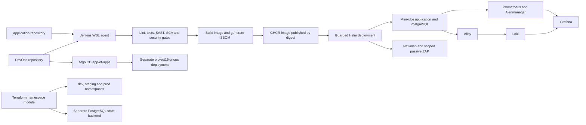

# Project 15 — DevSecOps infrastructure

Infrastructure, delivery automation and operational evidence for the Project 15 Flask e-commerce API.

- Application repository: https://github.com/kfir-dev/project15-app
- DevOps repository: https://github.com/kfir-dev/project15-devops

## Architecture

## Delivery pipeline

The declarative Jenkinsfile checks out both repositories and runs:

1. GitLeaks over both Git histories.
2. Helm lint and Checkov.
3. Python environment setup and pip-audit.
4. Hadolint, flake8, pytest and coverage.
5. SonarQube with its Quality Gate.
6. Application image build and CycloneDX SBOM generation.
7. Grype and Trivy CRITICAL gates.
8. GHCR publication with image digest metadata.
9. Guarded deployment of the digest published by that build.
10. Newman smoke tests and scoped passive ZAP.

The deployment script checks the proposed changes, creates a protected database backup and verifies application health and preservation of database specifications, credential Secrets and existing PVC bindings.

Jenkins archives test, scan, publication and deployment evidence.

## Verified checkpoint

Jenkins build **#14** succeeded on **2026-10-22** using:

- DevOps commit: `3806299`
- Application commit: `e004bae`
- Hadolint: zero findings
- pip-audit: 59 dependencies, zero skipped and zero vulnerabilities
- Scoped passive ZAP: verified coverage and zero findings

This successful build demonstrates the implemented pipeline. It does not mean that every project requirement or every vulnerability category is fully covered.

## Environments and ownership

- `project15`: baseline application managed through Jenkins and Helm.
- `project15-gitops`: separate application managed by Argo CD.
- `monitoring`: Prometheus, Grafana and Alertmanager.
- `logging`: Loki and Alloy.
- `project15-tf-dev`, `project15-tf-staging` and `project15-tf-prod`: namespaces managed by Terraform.

Jenkins and Argo CD manage separate application resources. The GitOps application uses an explicitly pinned image; automatic image promotion from every Jenkins build into GitOps is not claimed.

## Operational guides

| Topic | Guide |
| --- | --- |
| Minikube | [Local cluster](docs/minikube.md) |
| Deployment and backups | [Deployment automation](docs/deployment-automation.md) |
| Container findings | [Security review](docs/container-security-review.md) |
| Kubernetes checks | [Checkov exception](docs/checkov-exceptions.md) |
| Dockerfile lint | [Hadolint](docs/dockerfile-lint.md) |
| API smoke tests | [Newman](docs/api-smoke-tests.md) |
| Passive API scan | [ZAP scope and evidence](docs/api-security-scan.md) |
| Metrics and alerts | [Monitoring](docs/monitoring.md) |
| Log collection | [Logging](docs/logging.md) |
| Terraform | [Workspaces and backend](docs/terraform-local.md) |
| GitOps | [Argo CD local setup](docs/argocd-local.md) |

Consult the guides and existing protected credential sources before starting services. Credentials must not be copied into Git or displayed through resolved configuration or raw state dumps.

## Local profile limits

Terraform manages namespaces in an existing Minikube cluster and uses a separate local PostgreSQL backend. Cluster provisioning and an S3 or Terraform Cloud backend are not implemented by that module.

Python SCA uses pip-audit. The specification names Dependency-Check or Snyk; this substitution must be disclosed.

ZAP covers three GET operations in passive mode. Authentication, write-operation security and full active DAST are outside that scope.

Application unit tests cover product, cart and order behavior, while the deployed Newman smoke collection currently covers three GET operations.

External Alertmanager notifications, branch-protection evidence and automated license-policy enforcement remain unverified or incomplete. Outstanding HIGH container findings are documented separately.

The GitHub Actions workflows provide additional checks; the complete publication and deployment path demonstrated here runs in Jenkins.

## Data preservation

Application, monitoring, logging and Terraform state use persistent storage. Stop services without deleting volumes or PVCs. Retain protected database backups outside Git. Do not use destructive reset commands as routine shutdown instructions.
